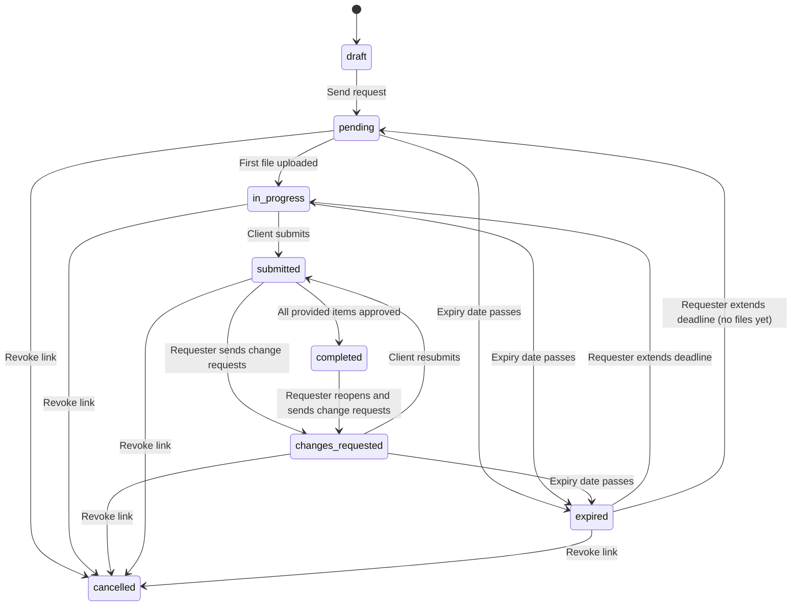

# MVP Specification: Client Document Collection Portal

Version 1.2, October 2026. Status: ready to build.

A requester sends a client one secure link. The client opens a mobile-friendly checklist, uploads files or photographs paperwork, and submits. The requester reviews item by item, asks for fixes where needed, and downloads a cleanly named ZIP.

**Launch market: US tax preparers, accountants, HR teams, lawyers and universities.** Starter templates come in groups for tax files, accounting, HR, legal and universities, plus the requester's own custom templates. The tax-season dates below still set the schedule, and the compliance mapping on the security page targets tax preparers and accountants (section 10). Build starts the week of October 26, 2026; the closed beta runs in December and public launch is before January 5, 2027, ahead of the US tax season (January to April). Missing that window costs a year of the strongest buying moment.

This document is the build spec for the first paid version. It revises the original plan (section 0), fixes inconsistencies, cuts scope to what a solo developer can ship in about seven weeks, and adds the UI and UX layer the original plan left out. Version 1.1 adds the infrastructure, security and go-to-market changes in rows 23 to 35 of section 0. Version 1.2 adds the decisions made while writing the module specs (`specs/`), in rows 37 to 46.

---

## 0. Changes from the original plan

The original plan is solid in shape. The changes below fix things that would have broken in production, or that contradicted each other across sections.

| # | Area | Original plan | Change | Why |
|---|------|---------------|--------|-----|
| 1 | Magic link in reminders | Only the SHA-256 hash of the token is stored, but reminder emails include "the recipient's direct link" | Store the hash (for lookup) **and** an AES-256-GCM encrypted copy of the token (for re-sending). Add "Regenerate link" to rotate it | With only a hash you cannot rebuild the link, so reminders and "resend invite" were impossible |
| 2 | Status model | Features list: Draft, Pending, In Progress, Submitted, Completed. DB: draft, in_progress, submitted, approved. Reminder query: `status != 'submitted'` | One enum: `draft`, `pending`, `in_progress`, `submitted`, `changes_requested`, `completed`, `expired`, `cancelled`, with explicit transitions (section 3) | Three different vocabularies would produce bugs in filters, reminders and emails |
| 3 | Rejection emails | Each "Request change" click emails the client immediately | Reviewer marks items, then clicks **Send change requests** once. One email lists every fix | Rejecting three items would otherwise send three emails in a minute |
| 4 | Reopening after rejection | Whole request goes back to `in_progress`; lock behavior unclear | New `changes_requested` status. Only rejected items unlock; approved and pending-review items stay locked; client clicks **Resubmit** | Keeps approved files safe and gives the dashboard a clear "waiting on client to fix" state |
| 5 | Debounce | "10 minutes of inactivity" in one place, "5 to 10 minutes" in another. QStash messages cannot be "superseded" by updating a Redis key. `activity_events` is append-only yet the digest reads "unnotified" events | Trailing-edge debounce: 10-minute quiet window, 30-minute maximum wait, a single scheduled job that re-checks and reschedules itself. Digest progress tracked by a cursor (`last_digest_event_id`) on the request, so events are never mutated | The described mechanism would either send duplicates or need to mutate the audit log |
| 6 | HEIC files | `IMG_2901.HEIC` becomes `John_Doe_Drivers_License.jpg` by renaming | Convert camera captures and HEIC to JPEG in the browser before upload. The extension in the ZIP always matches the real file format | Renaming an extension does not convert the file; the requester would get unopenable "JPGs" |
| 7 | ZIP file naming | `[Client_Name] - [Item_Name].[ext]` in one place, `John_Doe_W2_Form.pdf` in another | One convention (section 5.5) | Consistency |
| 8 | Files per item | One file per item with a version counter | Up to 10 files per item (multi-page statements, front and back of an ID). Client-removed files are soft-deleted | Phone users photograph documents page by page |
| 9 | Upload confirmation | Browser tells the server "upload done" and the server records it | Server verifies the object exists in S3 (HEAD request: size and content type) before marking it active. Unconfirmed uploads are cleaned up nightly | Never trust the client's word that a file exists |
| 10 | Token comparison | Hash the token, then use a timing-safe comparison | Look up by a unique index on `token_hash`. Timing-safe comparison is unnecessary for hash lookups | Simpler, and the security property is the same |
| 11 | "Link opened" events | Recorded when the page loads | Recorded by a client-side beacon after the page hydrates | Email security scanners (Outlook, Gmail) pre-open links and would create fake "opened" events |
| 12 | Runtime | "Vercel Edge / Serverless" | Node.js runtime for anything using `crypto`, the S3 SDK or ZIP streaming. Edge only for middleware. ZIP route sets `maxDuration` and uses no compression | These libraries need Node; PDFs and JPEGs don't compress, so compressing only burns CPU time |
| 13 | Transactions | Neon HTTP driver for everything | HTTP driver for simple reads; the pooled `Pool` driver (attached to the Fluid compute instance with `attachDatabasePool`) and real `db.transaction()` for multi-statement writes such as "reject items + change status + log events" | The Neon HTTP driver does not support interactive transactions, and `db.batch()` cannot branch on intermediate results |
| 14 | Bot protection | Turnstile runs on the recipient page (implied per upload) | Turnstile verified once when the portal opens; a signed, short-lived cookie covers later uploads | A challenge per upload adds latency on mobile data |
| 15 | Email DNS | SPF, DKIM, DMARC in Phase 4 | Phase 1 | If the first magic link lands in spam, the product doesn't work. SES requires domain verification before sending anyway |
| 16 | Monitoring | Sentry and PostHog in Phase 4 | Phase 1. PostHog session replay masks all inputs and never records document previews | You need error data during beta, and recording clients' tax documents would be a privacy incident |
| 17 | Requester auth | Not specified | Better Auth with Drizzle adapter: email magic link plus Google sign-in | Fits the stack, no extra vendor |
| 18 | Data lifecycle | Links lock after approval; files kept forever | Add **Revoke link**, **Delete files**, and a retention policy (default 90 days after completion) | Sensitive financial and identity documents shouldn't live forever by default |
| 19 | Billing gate | "Gate active requests behind a subscription" | Gate only creating and sending requests. Clients can always finish an open request. 14-day free trial | A lapsed card should never block the requester's client mid-upload |
| 20 | Trust in emails | Generic sender | Emails show the requester's business name ("Acme Accounting via DocuLink") with reply-to set to the requester. Portal shows their name and logo | An unknown sender asking for a driver's license looks exactly like phishing |
| 21 | Reminder timing | One daily cron in UTC | Hourly scheduler; reminders go out between 9 and 11 am in the requester's time zone; maximum 5 per request; idempotent claim so QStash retries never double-send | A 3 am reminder is ignored; retries are normal in QStash |
| 22 | Missing basics | none | Checklist templates, "Duplicate request", submission receipt email to the client, "Extend deadline" | Requesters send the same checklist over and over |
| 23 | Requester MFA | Email magic link and Google only | TOTP two-factor (Better Auth `twoFactor` plugin) with backup codes, required before a requester can preview or download any file. Passkeys later | The FTC Safeguards Rule requires MFA for anyone accessing customer information, and tax preparers are covered by it. Firms ask about it in every security review |
| 24 | Bounced invites | Not handled | SES delivery, bounce and complaint events flow to `/api/webhooks/aws`. The request shows "Invite bounced"; the requester corrects the email and resends. "Resend invite to a corrected address" moves from should-have to must-have | A mistyped email otherwise stalls the request silently while the requester waits |
| 25 | Malware scanning | Post-MVP | GuardDuty Malware Protection for S3 scans every new object. Preview, download and ZIP are blocked until a file is clean; infected files are quarantined and the client is asked to upload again | Requesters open client files on office machines. The AWS-native scanner needs almost no code |
| 26 | ZIP delivery | Always streamed through a Vercel function | Requests up to 200 MB stream directly as before. Larger ones are built by a background job into S3 and downloaded through a presigned URL, with an email when ready | Streaming 1 GB through a function pays egress twice and races `maxDuration` |
| 27 | File integrity | HEAD check of size and type | Browser computes SHA-256; the checksum is signed into the presigned PUT (`x-amz-checksum-sha256`) and stored on the file row | S3 rejects corrupted uploads, and the requester can prove exactly which file was received |
| 28 | AWS credentials | Long-lived access keys in environment variables | Vercel OIDC federation to one IAM role, scoped to the bucket, the KMS key and the SES identity | No static keys to leak or rotate. The first thing a security questionnaire asks about |
| 29 | Regions and accounts | Unspecified | Vercel functions (`iad1`), Neon (`aws-us-east-1`), S3 and SES (`us-east-1`) in one region. Separate AWS accounts for production and staging, managed with infrastructure as code | Lower latency, no cross-region transfer costs, smaller blast radius |
| 30 | Encryption at rest | S3 default encryption | SSE-KMS with a customer-managed key and S3 Bucket Keys, Block Public Access on, bucket policy denying non-TLS requests, versioning with a 7-day expiry of non-current versions | Lets us answer "who can decrypt the documents" precisely, and recovers from accidental deletes |
| 31 | Ownership model | Everything owned by `user_id` | Everything owned by `workspace_id`. MVP creates one workspace per user with one member; the Team tier adds members without a data migration | Teams are the first post-launch feature (the Team settings design already exists). Re-keying every table later is painful |
| 32 | Pricing | One plan, $20/month | Solo plan $29/month or $290/year. Team plan planned for after launch (section 11) | $20 leaves no room for expansion revenue, and accounting firms have several staff |
| 33 | Sales tax | Not handled | Stripe Tax on Checkout and subscriptions | SaaS is taxable in many US states |
| 34 | Market | Mixed US and UK conventions ("driver's licence" next to W-2 and 1099) | US first: US spelling, US tax templates, US time zones as defaults | Market choice drives data residency, retention rules and copy |
| 35 | Compliance positioning | "Not certified" only | Public security page mapping our controls to the FTC Safeguards Rule and IRS Publication 4557, plus each vendor's SOC 2 report kept on file for customer questionnaires. Still no certification claims | Accountants need to show their own Safeguards Rule program covers the vendors they use |
| 36 | Design tokens | Colors sampled from the PNG mockups; 180 ms stamp animation | Tokens, type stacks, layout, motion and the 400 ms seal taken from `Designs/DocuLink Design System v2.html`, which is now the visual source of truth (5.2, 5.4, 5.9). Two deliberate exceptions: dates use US formats, and the "Clients" nav item is post-MVP (1.3). The cat mark gets a vector version | The sampled colors drifted from the source, and the sampled input border (1.4:1) failed WCAG 1.4.11; the design system's control border passes at 3.4:1 |
| 37 | Audience | US tax preparers first; mortgage, lending and rental templates | Tax preparers, accountants, HR teams, lawyers and universities. Starter templates are grouped as Tax files, Accounting, HR, Legal and Universities, plus Custom for the requester's own, each group with its own icon (5.3, 7 `templates.category`) | Product decision (Oct 20, 2026): the same collection loop serves all five audiences, and the groups make the right starting point easy to find |
| 38 | Name, domain and sender | Placeholders ("[App Name]" and "[DocuLink]") | DocuLink at `doculinkapp.com`. Email is sent from `requests@mail.doculinkapp.com` | The SES identity, DNS and Terraform need the final domain in week 1. `requests@` reads less like a marketing sender than `notify@` |
| 39 | Reopening a completed request | `completed` was final | **Reopen** on the completed view lets the requester un-approve items and draft notes. Sending them moves the request `completed → changes_requested` with one email, like any change request (3.1, 4.4) | The design has Reopen, and approving the last item by mistake otherwise had no undo. Reusing the change-request flow adds no new client screen |
| 40 | Retention | 30, 90 or 365 days; automatic deletion a should-have | 30 days, 90 days (default) or a custom number of days from 1 to 365. Automatic deletion is a must-have; only the 7-day warning email stays a should-have. A changed setting applies to requests already completed, after a warning that says how many will be deleted (4.7) | The landing page, the client screens and the security page all promise automatic deletion, so it must be true at launch |
| 41 | Phone handoff | Open question (15 Q6) | Must-have: on desktop, the portal shows "Paper copy? Use your phone" with a QR code of the same link, generated in the browser (5.6) | Clients often open the email on a laptop while the paperwork needs photographing |
| 42 | Sign-in and two-factor | The magic link signs in when opened; Google sign-in and two-factor unspecified | The sign-in link opens a "Confirm sign-in" page with one button. Google's own 2-Step Verification does not count as our two-factor (10) | Corporate email scanners open links and would use up the sign-in link. We can't verify Google's second factor, and the FTC Safeguards Rule expects us to enforce MFA ourselves |
| 43 | Reminder opt-out | None | Reminder emails carry a one-click `List-Unsubscribe` header and a "Stop reminders for this request" link. It stops scheduled and manual reminders for that request only, and the requester sees it (5.7, 7, 9.3) | Gmail and Yahoo sender rules favor it, and a client who wants fewer emails shouldn't have to mark them as spam |
| 44 | Data model additions | None | `document_requests.number` (shown as "No. 0142"); `workspaces.next_request_number`, `onboarded_at`, `past_due_since` and `deleting_at`; `checklist_items.reason` (the "Why:" line); `templates.category`; `reminder_schedules.stopped_by_recipient_at`, with `next_send_at` nullable for drafts; `zip_exports.file_set_hash` (7) | Each one backs a screen in the designs or a rule in a module spec |
| 45 | Smaller corrections from the module specs | Various | `proxy.ts` (Node.js) replaces Edge middleware; the IAM role gains the version, tagging and multipart permissions that deletion needs; a quarantine key prefix; an audit-log trigger bypass used only by account deletion and Delete draft; PDFs previewed with pdf.js (scripting off) instead of an iframe; logos PNG, JPEG or WEBP only; client thumbnails only for clean files; Delete draft removes the draft; submitting needs at least one file; `unapproveItem` and `removeBlockedFile`; the dashboard follows its design; Settings tabs are Workspace, Security, Billing and Account, with Templates in the top nav; beta pricing is a promotion code | Found while writing the module specs; each is described where it lands below |
| 46 | SOC 2 | A post-launch decision, nothing until then | SOC 2 readiness from day one: the engineering controls (change review, vulnerability scanning, one-year logs, staff access through SSO with MFA, a production data access rule, incident response) and the people controls for every hire run from the start. The policies, compliance platform, penetration test and audit wait until firms ask (10, 13, 14) | A Type II report can only cover months in which the controls were already running and leaving evidence. The team starts with one person and will grow, so each control has a solo form now and a team form later |

---

## 1. Scope

### 1.1 Must have (launch blockers)

Requester:
- Sign up and sign in (email magic link, Google).
- Two-factor authentication (TOTP plus backup codes), required before viewing any file.
- Workspace profile: business name, logo, time zone, reply-to email.
- Create, edit, send, duplicate, revoke and delete requests.
- Checklist builder: label, helper instructions, required or optional, reorder.
- Save a checklist as a template; start a request from a starter template (grouped as Tax files, Accounting, HR, Legal and Universities) or a custom one.
- Dashboard grouped by what needs attention.
- Request detail: progress, per-item files, activity timeline.
- Inline preview (PDF and images) and single-file download.
- Approve items; request changes with a note; send all change requests in one email.
- Reopen a completed request by sending new change requests.
- Download ZIP with standardized names (direct stream up to 200 MB, prepared in the background above that).
- Reminder settings per request (off, every 2, 3, 5 or 7 days).
- Regenerate link, extend deadline, delete files.
- "Invite bounced" flag; correct the client's email and resend the invite.
- Stripe subscription (Solo, $29/month or $290/year) with 14-day trial, Stripe Tax and customer portal.

Recipient:
- Passwordless access through the link.
- Checklist with progress, helper text and due date.
- Take photo (camera) or choose file; multiple files per item.
- Upload progress, retry on failure, remove a file before submitting.
- Progress saved automatically; continue on any device from the same link.
- Submit gate once required items are filled.
- Clear rejected-item state with the requester's note; resubmit.
- Locked, completed, expired and revoked states.
- On desktop, a QR code that opens the same link on a phone.
- Stop reminders for a request from the reminder email.

System:
- Direct-to-S3 uploads with server-side verification and SHA-256 checksums.
- Malware scan of every upload (GuardDuty Malware Protection for S3); nothing is previewable or downloadable until clean.
- Debounced upload digest to the requester; immediate email on submit.
- Email delivery, bounce and complaint tracking (SES events).
- Reminder scheduler, expiry, orphan cleanup, automatic retention deletion (every S3 version).
- Audit log of every meaningful event.
- Rate limiting, Turnstile, private KMS-encrypted bucket, signed URLs only.
- Public security page ("How we protect client documents") mapped to the FTC Safeguards Rule and IRS Publication 4557.
- Public pages: landing, pricing, a sample request anyone can try (`/sample`), "How is my data protected?", "Why did I get this?" and the legal pages.

### 1.2 Should have (first 4 weeks after launch)
- A 7-day retention warning email (automatic deletion and manual delete are must-haves).
- Magic-byte file type check (read the first bytes from S3 during confirmation).
- Combine multiple photos into one PDF in the browser.
- CSV manifest inside the ZIP.
- Passkeys for requester sign-in.

### 1.3 Later (explicitly out of the MVP)
- Teams, roles and shared workspaces. **First post-launch priority** (Team plan, section 11). The data model is workspace-owned from day one so this needs no migration. The design `5 Settings - 02 Team.png` is a post-MVP screen; hide the Team tab in the MVP settings.
- Client accounts or portals listing several requests, and the requester's Clients screen (the "Clients" nav item in the designs). The MVP nav is Requests, Templates, Settings.
- E-signatures, form fields, questionnaires.
- Integrations (Google Drive, Dropbox, practice management software).
- SMS reminders.
- White-label custom domains.
- OCR and automatic document validation.

---

## 2. Users and core jobs

| User | Job to be done | What success feels like |
|------|---------------|--------------------------|
| Requester (at launch: a US tax preparer, accountant, HR team, lawyer or university office) | "Get every document I need from this client, in a usable state, without chasing." | Opens the dashboard, sees one request marked "Needs review", approves it in two minutes, downloads a tidy ZIP |
| Recipient | "Send my accountant what they asked for without fuss, from my phone." | Taps the email link, photographs three documents, taps Submit, gets a receipt. No account, no app |

Design for the recipient first. They have no loyalty to the product, are often on a phone with a poor connection, and are handing over sensitive documents to a link they received by email. Every drop-off on their side becomes a chase email for the requester.

---

## 3. Lifecycle and state machines

### 3.1 Request status



| Status | Dashboard label | Client can upload? | Reminders? |
|--------|-----------------|--------------------|------------|
| `draft` | Draft | No link exists | No |
| `pending` | Sent | Yes | Yes |
| `in_progress` | In progress | Yes | Yes |
| `submitted` | Needs review | No (locked) | No |
| `changes_requested` | Changes requested | Only rejected items | Yes |
| `completed` | Completed | No (read-only summary) | No |
| `expired` | Expired | No | No |
| `cancelled` | Revoked | No | No |

Notes:
- `expired` extended with no files uploaded returns to `pending` rather than `in_progress`.
- Expiry default: due date + 14 days. With no due date: 60 days after sending.
- `completed` requires every item that has files to be approved. Optional items with no files are shown as "Not provided" and don't block completion.
- Completion happens on the approve that makes every provided item approved (event `ALL_APPROVED`).
- **Reopen** (completed, files not yet deleted): the requester un-approves items and drafts notes. **Send change requests** then moves the request to `changes_requested`, clears `completed_at`, extends `expires_at` to at least 14 days from now, resumes reminders and logs `request_reopened`.
- **Delete draft** removes the draft and its items. A draft never reaches `cancelled`.

### 3.2 Checklist item status

| Status | Meaning | Client sees |
|--------|---------|-------------|
| `pending` | No active files | "Add file" |
| `uploaded` | At least one active file, not yet reviewed | Green check, file names |
| `approved` | Requester accepted it | Green check, locked |
| `rejected` | Requester asked for a change (only visible to the client after "Send change requests") | Orange banner with the note, files editable |

A rejection is saved as a draft on the requester's side (`rejection_note` set, `rejection_sent_at` null) until they click **Send change requests**. Only then does the item become `rejected` for the client and the request move to `changes_requested`.

---

## 4. End-to-end flows (revised)

### 4.1 Create and send
1. Requester clicks **New request**, optionally picks a template.
2. Fills client name, client email, request title, optional due date, optional personal message.
3. Adds checklist items (label, instructions, required toggle) and picks reminder frequency.
4. Clicks **Preview as client** (optional) to see the mobile portal.
5. Clicks **Send request**. The server:
   - Checks the subscription is active or trialing.
   - Generates 32 random bytes, encodes as base64url (the token).
   - Stores `sha256(token)` in `token_hash` and the AES-256-GCM encryption of the token in `token_ciphertext`.
   - Sets status `pending`, `sent_at`, `expires_at`, creates the reminder schedule.
   - Sends the invite email ("Acme Accounting via DocuLink", reply-to the requester) through the SES configuration set, storing the SES message ID so delivery and bounce events can be matched back to the request.
   - Logs `request_sent`.

### 4.2 Client intake
1. Client taps the link: `/c/{token}`. Server hashes the token, looks it up, checks status and expiry, and renders the portal. Response headers: `Referrer-Policy: no-referrer`, `Cache-Control: no-store`, `X-Robots-Tag: noindex`.
2. After hydration, the page runs Turnstile invisibly, posts the result to `/api/portal/session`, and receives a signed httpOnly cookie valid for 12 hours, scoped to that request. A beacon logs `link_opened` (at most once per 30 minutes).
3. Client taps **Add file** on an item and picks **Take photo** or **Choose file**.
4. Browser preparation:
   - Camera captures and HEIC/HEIF files are converted to JPEG (longest edge 2400 px, quality 0.85). HEIC conversion library is loaded only when needed.
   - Type check: PDF, JPEG, PNG, HEIC/HEIF, WEBP. Max 25 MB per file, 10 files per item.
   - SHA-256 of the final bytes, computed with Web Crypto (in a worker for large files).
5. `POST /api/portal/uploads/presign` with item id, file name, content type, size and SHA-256. Server validates the session, request status, item status, rate limit, type and size; creates an `uploaded_files` row with status `pending`; returns a presigned PUT URL (15 minutes) with `Content-Type`, `Content-Length` and `x-amz-checksum-sha256` signed. S3 rejects the upload if the bytes don't match the checksum.
6. Browser uploads directly to S3 with a progress bar. On network failure it retries up to 3 times with backoff, then shows **Retry**.
7. `POST /api/portal/uploads/confirm`. Server sends a HEAD request to S3, checks size, type and checksum match, marks the file `active` with `scan_status = pending`, sets the item to `uploaded`, moves the request from `pending` to `in_progress` if needed, logs `file_uploaded`, and triggers the debounce (section 8.1).
8. GuardDuty scans the new object automatically (usually within seconds) and reports the result to `/api/webhooks/aws` (section 8.4). The client is not shown scan status unless a file fails, in which case the item shows "We couldn't accept this file. Please upload it again." and the file is removed from their list.
9. The client can leave at any time. Opening the same link on another device shows the same state.

### 4.3 Submit
1. **Submit documents** becomes active when every required item has at least one active file, at least one file has been added overall, and no upload is still in progress.
2. A confirmation sheet lists what will be sent and any optional items left empty.
3. On confirm: status `submitted`, `submitted_at` set, reminders paused, pending digest cancelled (cursor advanced), immediate email to the requester ("John Doe submitted 4 documents for 2026 Tax Return"), receipt email to the client. Logs `request_submitted`.
4. The portal shows the success screen and becomes read-only.

### 4.4 Review and change requests
1. Requester opens the request (two-factor verified in this session). Each item shows its files with thumbnails; clicking opens a preview panel using a presigned GET URL (10 minutes, `inline` disposition for PDF and images). Files still being scanned show "Scanning..." with no preview; files that failed the scan show "Blocked: failed the security scan" and can only be removed or used as the reason for a change request.
2. Per item: **Approve** or **Request changes** (opens a note field with quick-pick reasons: "Blurry or unreadable", "Pages missing", "Wrong document", "Expired document", "Other").
3. The review bar shows "3 approved, 1 change to send". Clicking **Send change requests** runs one transaction: items to `rejected`, `rejection_sent_at` set, request to `changes_requested`, events logged, reminders resumed. One email to the client lists every item and note.
4. If everything is approved, the request moves to `completed` automatically and the client link becomes a read-only summary.
5. **Reopen** on a completed request (until its files are deleted): the requester un-approves the items that need another look and drafts notes, then sends them as in step 3. The request moves to `changes_requested` and the client gets one email.

### 4.5 Client fixes
1. Client opens the link (from the email, which deep-links to `/c/{token}#item-{id}`). Rejected items are shown first with the requester's note.
2. They can remove files from rejected items and add new ones. Other items are locked.
3. **Resubmit** becomes active when every rejected item has been changed (at least one file added or removed since rejection). Status returns to `submitted`; the requester gets an immediate email.

### 4.6 Download
1. **Download ZIP** is available from `submitted` onwards. When not all items are approved, a note says "Includes unreviewed files." Only files with `scan_status = clean` are included; if any are still scanning the button waits ("Finishing security scan...").
2. Up to 200 MB of active files: the route streams from S3 into a ZIP stream without compression, straight to the response.
3. Above 200 MB: the button reads **Prepare ZIP**. A background job (section 8.5) streams the files into a ZIP that is written to S3 with a multipart upload under `exports/{requestId}/{exportId}.zip`. The page shows "Preparing your ZIP..." and the requester also gets an email when it's ready. The download is a presigned GET (10 minutes, `attachment`). Export objects expire after 24 hours by lifecycle rule.
4. Naming follows section 5.5. Logs `zip_downloaded` (and `zip_prepared` for background exports).

### 4.7 Close out
- **Revoke link**: status `cancelled`, token invalidated, client sees "This request has been closed."
- **Delete files**: deletes every object in S3 for the request, marks files `removed`, keeps metadata and audit log. Irreversible, requires typing the client's name.
- Retention: completed requests have their files deleted automatically (every S3 version) after the workspace's retention setting: 30 days, 90 days (default) or a custom number of days from 1 to 365. Changing the setting applies to requests already completed; the save dialog first says how many requests' files the next nightly run will delete.

### 4.8 Bounced invite
1. SES reports a hard bounce or complaint for an invite, reminder or change-request email (section 8.4).
2. The request gets `invite_bounced_at`, reminders pause, and `email_bounced` is logged. The dashboard row and request header show "Invite bounced" in the attention color, and the requester gets an email: "Your request to john@exampel.com bounced."
3. The requester clicks **Fix email**, corrects the address and clicks **Resend invite**. The server regenerates the token (the old link may sit in someone else's inbox), clears `invite_bounced_at`, resumes reminders and logs `invite_resent`.
4. Soft bounces are retried by SES and only surfaced if delivery ultimately fails.

---

## 5. UI and UX

### 5.1 Principles
1. **Calm and official.** People are handing over identity and financial documents. The interface should feel like a well-run office, not a growth-hacked SaaS app. No confetti, no emoji in UI copy, no dark patterns.
2. **One next action per screen.** The dashboard answers "what needs me?". The portal answers "what do I still need to send?".
3. **The requester's brand, not ours, on the client side.** The client portal leads with the requester's name and logo; our brand is a small footer.
4. **Phone first for the client, desktop first for the requester.** The recipient portal is designed at 375 px wide and scales up. The requester dashboard is designed at 1280 px and must still work on a tablet.
5. **Status is never color alone.** Every status has an icon and a text label.

### 5.2 Visual direction

The subject is paperwork: folders, stamps, carbon copies. The memorable element is the **seal**: when a requester approves an item, a round ink seal ("Approved") lands on the file card. It drops from 1.8× scale at −16°, presses to 0.93× and settles at 1× in 400 ms, once, and respects reduced motion. The same seal appears on the client's success screen ("Received") and on a completed request ("Complete"). Everything else stays quiet.

The full design system (principles, brand, color, type, layout, icons, components, motion, voice) is `Designs/DocuLink Design System v2.html`. Open it in a browser; it needs JavaScript. Where it and this document differ on visual details, the design system wins; on behavior and copy, this document wins.

### 5.3 Requester screens

**Sign in.** Email field, "Email me a sign-in link", "Continue with Google". After sending: "Check your inbox for a link from DocuLink. It expires in 15 minutes." The emailed link opens a "Confirm sign-in" page with one **Sign in** button, so email security scanners that open links can't use it up. When two-factor is on, a second step asks for the 6-digit code from the authenticator app, with "Use a backup code" below. "Trust this device for 30 days" is offered and off by default.

**Two-factor setup.** Forced on first sign-in, right after onboarding step 1: "Client documents need a second lock. Scan this code with an authenticator app." QR code, manual key, code field, then 10 backup codes to download or copy. Until set up, the requester can create and send requests but cannot preview or download files.

**Onboarding (3 steps, skippable after step 1).**
1. Business name and time zone (required).
2. Logo upload and reply-to email.
3. Create your first request from a starter template, picked by group (Tax files, Accounting, HR, Legal, Universities), or start from scratch.

**Dashboard.** Grouped by who has the next move, not by raw status. The layout follows the design `2 Requester dashboard - 01 Requests.png`: a headline ("3 to review." and the next due request), cards for requests that need review, a "Waiting on client" table, and counts that act as the tabs. The wireframe below shows the behavior, not the layout:

```
+----------------------------------------------------------------------+
| [Logo] Acme Accounting                        [New request]  (Avatar) |
+----------------------------------------------------------------------+
| Needs review (3) | Waiting on client (12) | Completed | Drafts (1)   |
| [Search clients or titles...]                     Sort: Last activity |
+----------------------------------------------------------------------+
| John Doe          2026 Tax Return        Needs review    Submitted 2h |
|                   5 of 5 items                           Due Oct 15   |
|----------------------------------------------------------------------|
| Priya Shah        Mortgage pre-approval  Changes req.    Sent fix 1d  |
|                   6 of 7 items, 1 to fix                 Due Oct 2    |
|----------------------------------------------------------------------|
| Mark Olsen        Lease application      In progress     Opened 3h    |
|                   2 of 4 items                           Due tomorrow |
+----------------------------------------------------------------------+
```

- "Needs review" is the default tab when it has items.
- "Waiting on client" includes Sent, In progress, Changes requested, Expired.
- "Completed" includes revoked requests, shown with the "Revoked" badge.
- Rows show last meaningful activity ("Opened 3h ago", "Uploaded 2 files 20m ago"), and "Due tomorrow" or "Overdue" in the attention color.
- A bounced invite shows "Invite bounced" in place of the activity text, in the attention color, and sorts to the top of "Waiting on client".
- Row menu: Open, Copy link, Send reminder now, Fix email (only when bounced), Duplicate, Revoke.
- Empty state (first run): "Send your first request. Pick a template or start from scratch." with the two buttons.
- Mobile: rows become stacked cards, tabs become a segmented control.

**New request (builder).** Single page, two columns on desktop (form left, live phone preview right), one column on mobile.

```
+----------------------------------------+---------------------------+
| Client                                  |   Live preview (phone)    |
|  Name [John Doe          ]              |   +-------------------+   |
|  Email [john@example.com ]              |   | Acme Accounting   |   |
|                                         |   | 2026 Tax Return   |   |
| Request                                 |   | 0 of 3 added      |   |
|  Title [2026 Tax Return  ]              |   | [ ] W-2 form      |   |
|  Due date [Oct 15, 2026 ] (optional)    |   | [ ] 1099-INT      |   |
|  Message to client (optional)           |   | [ ] Photo ID      |   |
|  [Hi John, here's what I need...    ]   |   +-------------------+   |
|                                         |                           |
| Checklist            [Load template v]  |                           |
|  :: W-2 form            Required [on]   |                           |
|     Instructions [All pages, from ...]  |                           |
|  :: 1099-INT            Required [off]  |                           |
|  :: Photo ID            Required [on]   |                           |
|     Instructions [Front and back...]    |                           |
|  [+ Add item]                           |                           |
|                                         |                           |
| Reminders  (Every 3 days v)  until done |                           |
|                                         |                           |
| [Save draft]  [Save as template]        |          [Send request]   |
+----------------------------------------+---------------------------+
```

- `::` is a drag handle; items can also be reordered with keyboard (up/down buttons appear on focus).
- Enter in the last item label adds a new item.
- Validation inline, on blur: email format, at least one item, title required.
- **Send request** confirmation dialog: "Send to john@example.com? They'll get an email from Acme Accounting via DocuLink." Buttons: **Send request**, Cancel. Toast afterwards: "Request sent to John Doe."

**Request detail and review.** The page where requesters spend most of their time.

```
+----------------------------------------------------------------------+
| < All requests                                                       |
| 2026 Tax Return                                 [Needs review]       |
| John Doe, john@example.com       Submitted Sep 22, 2:30 pm          |
| [Download ZIP] [Copy link] [...]                                    |
+-------------------------------------------+--------------------------+
| Items                                     | Preview                  |
| (v) W-2 form               Approved       | +----------------------+ |
|     w2_2025.pdf  412 KB                   | |                      | |
| (!) Photo ID               Review         | |   [ document image ] | |
|     IMG_1.jpg  front   [thumb]            | |                      | |
|     IMG_2.jpg  back    [thumb]            | +----------------------+ |
|     [Approve]  [Request changes]          | IMG_1.jpg, 1.8 MB        |
| ( ) 1099-INT   Not provided (optional)    | [Download] [Open in tab] |
+-------------------------------------------+--------------------------+
| 1 approved, 1 to review          [Send change requests (0)]          |
+----------------------------------------------------------------------+
| Activity                                                             |
| 2:30 pm  John submitted 3 files                                      |
| 2:18 pm  John uploaded "Photo ID" (2 files)                          |
| 2:15 pm  John opened the link                                        |
| Sep 20   Reminder sent (1 of 5)                                      |
+----------------------------------------------------------------------+
```

- Keyboard review: J/K to move between items, A to approve, R to request changes, arrow keys between files in the preview. Shortcuts shown in a "?" popover.
- Approve lands the "Approved" seal on the item card.
- **Request changes** expands an inline panel under the item: quick-pick reason chips plus a text field ("Tell John what to fix"). Saving shows the item as "Change drafted" with an Undo.
- The sticky review bar counts drafted changes. **Send change requests (2)** opens a preview of the email the client will receive, then sends.
- When everything is approved: the completed view (design `3 Document review - 02 Complete.png`) with the "Complete" seal, **Download ZIP** as the primary button, **Reopen**, and the retention line "Files will be deleted on Jan 15, 2027."
- Before submission, the page shows uploads as they arrive (read-only, no approve buttons) with a note: "You can review once John submits."
- Header menu: Send reminder now, Extend deadline, Fix email and resend, Regenerate link, Revoke link, Delete files.
- Activity sits in a collapsible "History" section below the item list.
- **Reopen** puts a completed request back into review: items can be un-approved and notes drafted, then sent with **Send change requests** (3.1).
- If the client stopped reminders, the header says "{Client} turned off reminders" and Send reminder now is unavailable.
- Bounced invite: a banner under the header, "The invite to john@exampel.com bounced. Check the address and resend." with **Fix email**, which opens an inline field and **Resend invite**.
- File states in the item list and preview: "Scanning..." (spinner, no preview), clean (normal), "Blocked: failed the security scan" (no preview or download; actions: Remove, Request changes).
- Large requests: **Download ZIP** becomes **Prepare ZIP**, then "Preparing your ZIP..." with progress, then **Download ZIP** (link valid for 24 hours).

**Templates** (top nav). Fifteen starter templates grouped as Tax files, Accounting, HR, Legal and Universities, then the requester's own under Custom. Each group has its own icon (Lucide `Receipt`, `Calculator`, `Users`, `Scale`, `GraduationCap`, `PencilRuler`), always next to its text label. Editing a starter saves a copy in the workspace. A template saved from a request goes under Custom unless the requester picks another group.

**Settings.** Workspace (business name, logo, time zone, reply-to, default reminders and file retention; matches the `5 Settings - 01 Workspace` design), Security (two-factor, backup codes, trusted devices, active sessions), Billing (plan, monthly or annual, "Manage billing" opens Stripe portal), Account (sign-in methods, delete account). The Team tab from the designs is hidden until the Team plan ships.

**Billing states.**
- Trial: quiet banner "Trial ends in 5 days. Add billing to keep sending requests."
- Lapsed: **New request** and **Send request** open an upgrade dialog. Everything else, including reviewing and downloading, keeps working. Client links are never affected.

### 5.4 Design tokens

Taken from `Designs/DocuLink Design System v2.html` (section 03 Colour). The names are what the code uses. Every text pair passes 4.5:1 and the control border passes 3:1.

| Token | Hex | Use |
|-------|-----|-----|
| `brand` | `#1E3A2A` | Requester header, portal footer, brand panels |
| `on-brand` | `#CFE8D8` | Text and buttons on `brand` |
| `accent-on-brand` | `#A8DDBE` | Italic accent word and active nav underline on `brand` |
| `action` | `#2F7A52` | Primary button (one per view), required folio numbers, progress fill, focus ring |
| `action-pressed` | `#256443` | Hover and pressed states, links |
| `on-action` | `#F4FAF6` | Text on `action` and `done` fills |
| `done` | `#1E6743` | "Added", "Approved", the seal |
| `highlight` | `#DCEFE3` | Focus halo on fields, approved fill, avatars |
| `paper` | `#F3F5F1` | Page background |
| `surface` | `#FEFFFD` | Cards, panels, inputs |
| `mist` | `#E8EDE7` | Neutral fills, disabled buttons |
| `line` | `#E1E6DF` | Hairlines, dividers, progress track |
| `line-strong` | `#C9D1C8` | Dashed rules |
| `border` | `#858E86` | Control borders (inputs, selects, secondary buttons) |
| `ink` | `#18201B` | Primary text, rules, ink buttons ("Choose file") |
| `ink-2` | `#525A54` | Secondary text, metadata |
| `ink-3` | `#5F6760` | Disabled text, optional folio numbers |
| `attention` on `attention-tint` | `#86470A` on `#FAEBD2` | "To review", due soon, overdue, invite bounced, changes requested |
| `danger` on `danger-tint` | `#8F1C13` on `#FBE4E1` | Expired, upload errors, blocked files, destructive actions |

**Type.** System font stacks; the web fonts are fallbacks only and are self-hosted (never embed or redistribute Apple's font files).
- Display: `ui-serif, "New York", Newsreader, Georgia, serif`, Medium 500 and Medium Italic, never lighter. Titles, headlines, folio numbers, counts, quotes, the wordmark.
- Interface: `-apple-system, BlinkMacSystemFont, "SF Pro Text", "Instrument Sans", system-ui, sans-serif`, 400, 500 and 600. Body, labels, buttons, tables, navigation.
- Metadata: `ui-monospace, "SF Mono", SFMono-Regular, Menlo, "JetBrains Mono", monospace`, 400. Request numbers, file names, sizes, timestamps. Never sentences.
- Scales: display 160, 128, 96; headline 64, 48, 32; quote 24 italic; interface title 28/34, title 2 22/28, lead 19/28, headline 17/22, body 17/24, subhead 15/20, badge 13/18, footnote 13/18; mono 12/16. Minimum 13 px sans and 12 px mono.
- Sentence case everywhere. At most one italic word per headline, in `action` on paper or `accent-on-brand` on `brand`. Tabular figures for counts, dates and sizes.
- Dates are US format: "Oct 17, 2026" in text and "10/17/2026" in mono metadata. The design system's day-first examples ("17.10.2026") are not used.

**Brand mark.** The cat head, as a vector redraw of the design system's PNG: `Designs/brand/doculink-mark.svg`. Minimum 24 px, clear space of half its height, never recolored, outlined, rotated or stretched.

**Layout.** 4 pt base; spacing 4, 8, 12, 16, 24, 32, 48, 64, 96. 12-column grid at 1440 with 96 margins (80 in app screens) and 32 gutters; header 68 px. Review uses a 260 / fluid / 380 split. Radius: label 4, input 10, button 12, card 18, badges are pills. Three elevations: flat (hairline only), card, float.

**Icons.** Lucide line icons, 24 grid, 2 px stroke, always paired with a label.

**Motion.** Fast 120 ms (hover, press, toggle), base 200 ms (badge swap, item open, focus), slow 400 ms (seal, page reveal). Standard easing `cubic-bezier(.2,.7,.2,1)`; seal easing `cubic-bezier(.2,1.4,.4,1)`. No loops.

### 5.5 ZIP naming convention

```
John_Doe - 2026 Tax Return.zip
  01_W-2_Form.pdf
  02_Photo_ID_1.jpg
  02_Photo_ID_2.jpg
  03_1099-INT.pdf
```

- Folder name: `{Client Name} - {Request Title}`. File name: `{position:2}_{Item Label}[_{n}].{ext}`, where `_{n}` is added only when an item has more than one file, in upload order.
- The position prefix keeps the checklist order in any file manager.
- Sanitizing: transliterate to ASCII, spaces to underscores in file names, strip `\/:*?"<>|` and control characters, collapse repeats, max 80 characters per name.
- Extension comes from the verified MIME type, never from the original file name.

### 5.6 Recipient portal (mobile first)

**Landing / checklist.** First visit and every return visit land here.

```
+-------------------------------+
| [Acme logo] Acme Accounting   |
|                               |
| 2026 Tax Return               |
| For John Doe. Due Oct 15.     |
|                               |
| "Hi John, here's what I need  |
|  for this year's return."     |
|  Sarah Lee, Acme Accounting   |
|                               |
| 1 of 3 added  [=====-----]    |
|                               |
| +---------------------------+ |
| | (v) W-2 form              | |
| |     w2_2025.pdf, 412 KB   | |
| |     [Add another]         | |
| +---------------------------+ |
| | ( ) Photo ID      Required| |
| |     Front and back of     | |
| |     your driver's license | |
| |     [Add file]            | |
| +---------------------------+ |
| | ( ) 1099-INT      Optional| |
| |     [Add file]            | |
| +---------------------------+ |
|                               |
| Your files go straight to     |
| Acme Accounting over an       |
| encrypted connection.         |
+-------------------------------+
| [   Submit documents   ]      |  <- sticky, disabled until ready
| 1 required item left          |
+-------------------------------+
```

- The sticky bottom bar respects the safe-area inset and always explains why Submit is disabled ("1 required item left").
- Items with "Required" or "Optional" in text, not only an asterisk.
- Progress counts required and optional separately if optional items exist: "1 of 2 required added".
- A short trust line near the bottom plus a "How is my data protected?" link to a plain-language page.
- No sign-up prompts, no marketing, no chat widgets.
- On desktop, a "Paper copy? Use your phone" panel shows a QR code of the same link, generated in the browser, so the client can photograph documents with their phone. Hidden on phones and touch devices.
- Footer links: "How is my data protected?" and "Why did I get this?".

**Add file sheet.** Tapping **Add file** opens a bottom sheet:

```
+-------------------------------+
| Photo ID                      |
| Front and back of your        |
| driver's license              |
|                               |
| [ Take photo        ]         |
| [ Choose file       ]         |
|                               |
| PDF, JPG, PNG or HEIC.        |
| Up to 25 MB each.             |
+-------------------------------+
```

- **Take photo** uses `<input type="file" accept="image/*" capture="environment">`. **Choose file** uses `accept="application/pdf,image/*"` with `multiple`.
- On desktop, the sheet becomes a drop zone ("Drop files here or choose files"); **Take photo** is hidden where no camera is available.
- After a photo: a review step with the image, "Use photo" and "Retake", plus a tip line under photos: "Make sure all four corners are visible and the text is sharp." Then "Add another page" or "Done".

**Upload row states.**

| State | Display |
|-------|---------|
| Preparing | "Preparing photo..." (during HEIC conversion or resize) |
| Uploading | File name, progress bar with percent, Cancel |
| Done | Green check, file name, size, preview, Remove. The preview is the copy on the client's device; on a later visit a server thumbnail appears only once the file has passed the malware scan |
| Failed | Red text "Upload didn't finish. Check your connection.", **Retry** and Remove |
| Too large or wrong type | "This file is 41 MB. The limit is 25 MB." (upload never starts) |

Uploads for one item run in parallel (max 3 at a time). Leaving the page mid-upload triggers the browser's "leave site?" prompt.

**Submit confirmation sheet.**
"Send 4 files to Acme Accounting? You won't be able to change them unless Acme asks for a fix." Lists items and file counts; optional items left empty are shown as "Not included". Buttons: **Submit documents**, Keep editing.

**Success screen.** The "Received" seal, then: "Acme Accounting has your documents. We've emailed you a receipt. If they need anything else, you'll get an email with a link back here." No further actions.

**Changes requested.** On return, a banner at the top: "Acme Accounting asked you to fix 1 item." Rejected items move to the top with an attention-colored left border and the note in a quote block: "Only page 1 was attached, please include page 2." Other items show a lock icon and "Accepted" or "Under review". Bottom bar: **Resubmit**, with "Update 1 item to resubmit" while disabled.

**Terminal states.** One screen each, requester branded, with the requester's name and reply-to email as the way forward:
- Submitted (locked): "You've sent everything. Acme Accounting is reviewing it."
- Completed: "This request is complete. Your files were accepted on Sep 24."
- Expired: "This request expired on Oct 29. Contact Sarah Lee at sarah@acme.com to reopen it."
- Revoked: "This request has been closed by Acme Accounting."
- Invalid link: "This link isn't valid. Check you used the full link from your email." (Same page and timing for unknown and malformed tokens.)

### 5.7 Emails

All emails: plain, single column, requester branding on client emails, one primary button, and the full link as text below the button (some corporate mail clients strip buttons). Client emails come from `"Acme Accounting via DocuLink" <requests@mail.doculinkapp.com>` with reply-to set to the requester; requester emails come from `"DocuLink" <requests@mail.doculinkapp.com>`.

| Email | To | Subject | Primary button |
|-------|----|---------|----------------|
| Invite | Client | Acme Accounting needs documents for 2026 Tax Return | Add your documents |
| Reminder | Client | Reminder: 2 documents still needed for 2026 Tax Return | Add your documents |
| Change requested | Client | Acme Accounting asked you to update 1 document | Update documents |
| Submission receipt | Client | You sent 4 documents to Acme Accounting | none (summary only) |
| Upload digest | Requester | John Doe added 2 of 3 documents | Open request |
| Submitted | Requester | John Doe submitted documents for 2026 Tax Return | Review now |
| Resubmitted | Requester | John Doe updated 1 document | Review now |
| Expiring soon (should-have) | Requester | 3 requests expire this week | Open dashboard |
| Retention warning (should-have) | Requester | Files for 2 completed requests will be deleted on Oct 1 | Review requests |
| Sign-in link | Requester | Your sign-in link for DocuLink | Sign in |
| Invite bounced | Requester | Your request to john@exampel.com bounced | Fix email |
| ZIP ready | Requester | Your ZIP for 2026 Tax Return is ready | Download ZIP |
| Two-factor changed | Requester | Two-factor sign-in was turned off / backup codes were used | Review security |

Client emails never contain file names that could reveal content in a lock-screen preview beyond the requester's own item labels, and never attach files.

Reminder emails carry one-click unsubscribe headers (`List-Unsubscribe` with an HTTPS link, and `List-Unsubscribe-Post: List-Unsubscribe=One-Click`) and a footer link, "Stop reminders for this request". It stops scheduled and manual reminders for that request only; change requests still arrive. The requester sees "{Client} turned off reminders" on the request.

### 5.8 Loading, empty and error patterns
- Skeleton rows for the dashboard and item list; never a full-page spinner.
- Optimistic UI for approve and reorder, with rollback and an error toast on failure.
- Error copy says what happened and what to do: "Couldn't generate the ZIP. The file 'IMG_2.jpg' is missing from storage. Remove it from the request or ask the client to upload it again."
- Toasts use the same verb as the button: **Send request** then "Request sent"; **Approve** then "Approved"; **Send change requests** then "Change requests sent to John".

### 5.9 Accessibility
- WCAG 2.2 AA contrast for all tokens in 5.4 (pairs to check: ink and ink-2 on paper and surface, on-action on action and done, on-brand and accent-on-brand on brand, action-pressed on paper, attention on attention-tint, danger on danger-tint, done on highlight; border on surface and paper at 3:1).
- Touch targets at least 44 x 44 px on the portal.
- Visible focus on every interactive element: fields switch to an `ink` border with a `highlight` halo (design system); every other control gets a 2 px `action` ring with a 2 px offset (the halo alone is too faint on paper).
- Upload progress announced via `aria-live="polite"`; errors via `role="alert"`.
- Drag-to-reorder always has a keyboard alternative.
- `prefers-reduced-motion` disables the seal animation and every other transition (everything appears in its end state).
- Portal text at 17 px base; supports 200% zoom without horizontal scrolling.
- Language set on `<html>`; copy written at roughly an 8th-grade reading level.

---

## 6. Architecture

```
[ Requester browser ]      [ Client phone / browser ]
          |                        |          \
          v                        v           \  presigned PUT / GET
[ Vercel Pro (iad1): Next.js App Router, Node.js ]  \
   - Server Components + Server Actions (requester)  --> [ AWS S3, us-east-1 ]
   - Route Handlers (portal API, ZIP, jobs, webhooks)     private, SSE-KMS
   - proxy.ts (Node.js): auth redirect, security headers       |
   - AWS access via OIDC -> IAM role (no static keys)          | object created
          |                                                     v
          |                                      [ GuardDuty Malware Protection ]
          |                                                     |
          |      [ SES events ] ---> [ EventBridge ] <----------+ scan results
          |                                |
          |<------ POST /api/webhooks/aws -+  (API destination, shared secret)
          |
   +------+-----------+-------------+-------------+-------------+
   v                  v             v             v             v
[ Neon Postgres ] [ Upstash Redis ] [ QStash ]  [ SES ]       [ Stripe ]
 aws-us-east-1     rate limits,      delayed     all email,    subscriptions,
 Drizzle ORM,      debounce keys     jobs +      config set    Stripe Tax,
 pooled driver                       hourly cron with events   webhooks
          |
[ Sentry ] errors    [ PostHog ] product analytics (masked)
```

AWS resources (bucket, KMS key, IAM role, SES identity and configuration set, GuardDuty protection plan, EventBridge rules) are defined in one small infrastructure-as-code stack (Terraform) and deployed to separate production and staging AWS accounts.

| Piece | Choice | Notes |
|-------|--------|-------|
| Framework | Next.js (App Router), TypeScript, Tailwind CSS | Server Actions for requester mutations; Route Handlers for the portal and jobs |
| UI kit | Radix primitives (via shadcn/ui), styled to the tokens in 5.4 | Bottom sheet built on Radix Dialog |
| Hosting | Vercel **Pro** (Hobby forbids commercial use), function region `iad1` | Node.js runtime for routes using `crypto`, S3 SDK and ZIP; Fluid compute on; direct ZIP route and ZIP job `maxDuration = 300` |
| Database | Neon Postgres (`aws-us-east-1`) + Drizzle ORM | HTTP driver for simple reads; pooled `Pool` driver with `attachDatabasePool` and `db.transaction()` for multi-statement writes. Point-in-time restore enabled; check the retention window on the chosen plan |
| Auth | Better Auth + Drizzle adapter | Email magic link (sent via SES), Google, `twoFactor` plugin (TOTP, backup codes, trusted devices) |
| Files | AWS S3 via `@aws-sdk/client-s3`, `s3-request-presigner` and `lib-storage` | SSE-KMS with a customer-managed key and Bucket Keys; Block Public Access; TLS-only bucket policy; versioning (non-current versions expire after 7 days); CORS allows PUT and GET from the app origin only |
| AWS access | Vercel OIDC federation, `@vercel/functions/oidc` `awsCredentialsProvider` | One IAM role per environment, trust policy limited to this Vercel project and environment, permissions limited to the bucket, KMS key and SES identity |
| Malware scanning | GuardDuty Malware Protection for S3 | Scans every new object under `requests/`; tags the object and sends the result to EventBridge |
| Cache and limits | Upstash Redis + `@upstash/ratelimit` | Sliding-window limits |
| Jobs | Upstash QStash | Signature verified with `@upstash/qstash` `Receiver` on every job route |
| Email | AWS SES + React Email templates | Domain verified with SPF, DKIM, DMARC from day one; production access requested in week 1; sending from a subdomain (`mail.`) through a configuration set that publishes delivery, bounce and complaint events to EventBridge |
| AWS events | EventBridge rules with an API destination to `/api/webhooks/aws` | Shared secret header, verified on every call; covers SES events and GuardDuty scan results |
| Billing | Stripe Checkout, Customer Portal, webhooks, Stripe Tax | Solo plan, monthly and annual prices, 14-day trial |
| ZIP | `archiver` (store mode, level 0) piped through `Readable.toWeb` (direct) or into an S3 multipart `Upload` (background) | No disk, no full buffering |
| Client-side images | Canvas resize for captures; `heic2any` lazy-loaded | Runs before presign |
| Monitoring | Sentry (errors, performance, uptime), PostHog (events, masked replay), Axiom (application logs via the Vercel integration) | Replay disabled on preview components |

### 6.1 S3 key layout
```
requests/{requestId}/{itemId}/{fileId}
exports/{requestId}/{exportId}.zip      // background ZIPs, lifecycle-deleted after 24 hours
logos/{workspaceId}/{logoId}
quarantine/{requestId}/{fileId}         // infected files, lifecycle-deleted after 30 days, not scanned
```
No client names or original file names in keys. Original name is stored in the database only. GuardDuty scanning is limited to the `requests/` prefix.

### 6.2 Environment variables
```
DATABASE_URL                 # pooled connection string
BETTER_AUTH_SECRET, GOOGLE_CLIENT_ID, GOOGLE_CLIENT_SECRET
AWS_REGION, AWS_ROLE_ARN, S3_BUCKET    # credentials come from Vercel OIDC, no access keys
SES_FROM_EMAIL, SES_CONFIGURATION_SET   # requests@mail.doculinkapp.com
AWS_EVENTS_SECRET            # shared secret sent by the EventBridge API destination
UPSTASH_REDIS_REST_URL, UPSTASH_REDIS_REST_TOKEN
QSTASH_TOKEN, QSTASH_CURRENT_SIGNING_KEY, QSTASH_NEXT_SIGNING_KEY
STRIPE_SECRET_KEY, STRIPE_WEBHOOK_SECRET, STRIPE_PRICE_ID_MONTHLY, STRIPE_PRICE_ID_ANNUAL
TOKEN_ENCRYPTION_KEY         # 32 bytes, base64; used for token_ciphertext
PORTAL_SESSION_SECRET        # signs the portal cookie
EMAIL_LINK_SECRET            # signs reminder unsubscribe links
TURNSTILE_SITE_KEY, TURNSTILE_SECRET_KEY
SENTRY_DSN, NEXT_PUBLIC_POSTHOG_KEY
APP_URL                      # https://doculinkapp.com
```
Production and staging use separate values for everything, including separate AWS accounts, Neon projects, Stripe accounts (test mode for staging) and Upstash databases.

### 6.3 Hosting decision: Vercel + Neon + S3, not all-AWS

The app stays on Vercel and the database on Neon for the MVP. Documents, the sensitive part, already live in our own AWS account, and Neon runs on AWS in the same region. Moving the app and database onto AWS (ECS or App Runner, RDS, VPC, CI/CD, preview environments) would cost 2 to 4 weeks of a 7-week plan and buy customers nothing visible. Vercel, Neon, Upstash, Stripe, Sentry and PostHog all publish SOC 2 Type II reports, which is what customer security questionnaires ask for.

Stay portable so a move is cheap if it's ever needed:
- Node.js runtime for all app logic, including `proxy.ts`.
- Standard Postgres through Drizzle; no Neon-only features in application code.
- No Vercel-only storage (Blob, KV, Edge Config) for application data.
- Background jobs are plain HTTP routes, so they can move to Lambda unchanged.

Revisit when one of these happens:
- An enterprise customer requires a single cloud, private networking or a BAA a vendor can't provide on our plan.
- Vercel bandwidth or function time becomes a large share of the bill.
- We need long-running workers (OCR, PDF merging, large exports) beyond `maxDuration`.

Move piece by piece when it happens: workers to Lambda first, then Neon to RDS or Aurora Postgres, then the app.

---

## 7. Data model (Drizzle on Neon)

Better Auth creates its own `user`, `session`, `account` and `verification` tables, plus `twoFactor` and `user.two_factor_enabled` from the two-factor plugin. Business settings and billing live on `workspaces`. Every customer-owned row belongs to a workspace, not a user. The MVP creates one workspace per user on sign-up with a single `owner` membership; the Team plan adds members without a migration.

```ts
// enums
request_status: 'draft' | 'pending' | 'in_progress' | 'submitted'
              | 'changes_requested' | 'completed' | 'expired' | 'cancelled'
item_status:    'pending' | 'uploaded' | 'approved' | 'rejected'
file_status:    'pending' | 'active' | 'removed'
scan_status:    'pending' | 'clean' | 'infected' | 'failed'
export_status:  'queued' | 'building' | 'ready' | 'failed' | 'expired'
member_role:    'owner' | 'member'
actor:          'requester' | 'recipient' | 'system'
template_category: 'tax' | 'accounting' | 'hr' | 'legal' | 'university' | 'custom'

workspaces
  id                   uuid pk
  business_name        text not null
  logo_key             text null            // S3 key, public-safe copy via signed URL
  time_zone            text not null default 'America/New_York'
  reply_to_email       text null
  default_reminder_days int null default 3   // null = off
  retention_days       int not null default 90   // 1–365; settings offers 30, 90 or custom
  stripe_customer_id   text unique null
  subscription_status  text not null default 'trialing'  // trialing|active|past_due|canceled
  plan                 text not null default 'solo'      // solo|team
  billing_interval     text null                         // month|year
  trial_ends_at        timestamptz null
  current_period_end   timestamptz null
  past_due_since       timestamptz null         // start of the 7-day grace period
  next_request_number  int not null default 1   // assigns document_requests.number
  onboarded_at         timestamptz null
  deleting_at          timestamptz null         // account deletion in progress
  created_at, updated_at

workspace_members
  workspace_id         uuid -> workspaces.id on delete cascade
  user_id              text -> user.id on delete cascade
  role                 member_role not null default 'owner'
  created_at
  primary key (workspace_id, user_id)

templates
  id uuid pk, workspace_id -> workspaces.id, created_by -> user.id, name text,
  category template_category not null default 'custom'
  items jsonb   // [{label, instructions, reason, required}]
  unique (workspace_id, lower(name))
  // starter templates live in code, not in this table
  created_at, updated_at

document_requests
  id                   uuid pk
  workspace_id         uuid -> workspaces.id, indexed
  number               int not null         // per workspace, shown as "No. 0142"
  created_by           text -> user.id
  title                text not null
  recipient_name       text not null
  recipient_email      text not null
  message              text null
  status               request_status not null default 'draft'
  token_hash           text unique null     // sha256 hex of token
  token_ciphertext     text null            // AES-256-GCM(iv|tag|ct), base64
  due_date             date null
  expires_at           timestamptz null
  sent_at, first_opened_at, submitted_at, completed_at, cancelled_at,
  files_deleted_at     timestamptz null
  invite_bounced_at    timestamptz null     // set by SES bounce/complaint, cleared on resend
  last_digest_event_id bigint not null default 0
  created_at, updated_at
  index (workspace_id, status, updated_at desc)
  unique (workspace_id, number)

email_messages                                // maps SES events back to requests
  ses_message_id       text pk
  request_id           uuid null -> document_requests.id on delete cascade
  kind                 text not null        // invite|reminder|change_request|receipt|digest|...
  to_email             text not null
  status               text not null default 'sent'  // sent|delivered|bounced|complained
  created_at, updated_at

checklist_items
  id                   uuid pk
  request_id           uuid -> document_requests.id on delete cascade
  position             int not null
  label                text not null
  instructions         text null
  reason               text null            // the "Why:" line
  required             boolean not null default true
  status               item_status not null default 'pending'
  rejection_note       text null
  rejection_sent_at    timestamptz null    // null = drafted, not yet sent
  reviewed_at          timestamptz null
  updated_at
  unique (request_id, position)  // deferrable, or re-sequence in one batch

uploaded_files
  id                   uuid pk
  request_id           uuid -> document_requests.id on delete cascade
  item_id              uuid -> checklist_items.id on delete cascade
  s3_key               text not null unique
  original_name        text not null        // sanitized for display
  mime_type            text not null
  size_bytes           bigint not null
  sha256               text not null        // base64, verified by S3 on upload
  status               file_status not null default 'pending'
  scan_status          scan_status not null default 'pending'
  scanned_at           timestamptz null
  created_at, confirmed_at, removed_at
  index (item_id, status)
  index (status, created_at)  // orphan cleanup
  index (scan_status, confirmed_at) where scan_status = 'pending'  // stuck-scan check

zip_exports                                   // background ZIPs over 200 MB
  id                   uuid pk
  request_id           uuid -> document_requests.id on delete cascade
  requested_by         text -> user.id
  status               export_status not null default 'queued'
  s3_key               text null
  size_bytes           bigint null
  file_count           int null
  error                text null
  file_set_hash        text not null        // reuse a ready export until the files change
  created_at, ready_at, expires_at

activity_events                               // append-only
  id                   bigserial pk
  request_id           uuid -> document_requests.id on delete cascade
  actor                actor not null
  type                 text not null        // see list below
  item_id              uuid null
  file_id              uuid null
  meta                 jsonb not null default '{}'
  created_at           timestamptz not null default now()
  index (request_id, id)

reminder_schedules
  request_id           uuid pk -> document_requests.id on delete cascade
  interval_days        int not null
  next_send_at         timestamptz null     // null while the request is a draft
  sent_count           int not null default 0
  max_count            int not null default 5
  is_active            boolean not null default true
  stopped_by_recipient_at timestamptz null  // the client used the unsubscribe link
  index (next_send_at) where is_active
```

Event types: `request_created`, `request_sent`, `link_opened`, `file_uploaded`, `file_removed`, `request_submitted`, `item_approved`, `item_change_drafted`, `change_requests_sent`, `request_resubmitted`, `request_completed`, `reminder_sent`, `link_regenerated`, `deadline_extended`, `request_revoked`, `zip_downloaded`, `zip_prepared`, `file_previewed`, `files_deleted`, `request_expired`, `file_scan_clean`, `file_scan_infected`, `email_bounced`, `email_complained`, `invite_resent`, `request_reopened`, `reminders_stopped`.

Append-only enforcement: application code has no update or delete paths for `activity_events`; a Postgres trigger rejecting `UPDATE` and `DELETE` on the table is added in the first migration The trigger allows `DELETE` only when the transaction has run `SET LOCAL app.allow_event_delete = 'on'`, which only account deletion and Delete draft do. Without the bypass, cascaded deletes would fail too.

---

## 8. Background jobs

All job routes verify the QStash signature and are idempotent.

### 8.1 Upload digest (debounce)

On each confirmed upload or removal:
```
SET dg:last:{rid} = now
SET dg:first:{rid} = now NX EX 3600
if SET dg:job:{rid} = 1 NX EX 3600:
    qstash.publish('/api/jobs/digest', { rid }, delay = 10 min)
```

`/api/jobs/digest`:
```
if request.status not in (in_progress, changes_requested): clear keys; return
quiet = now - dg:last ; age = now - dg:first
if quiet < 10 min and age < 30 min:
    qstash.publish(same, delay = 10 min - quiet); return
DEL dg:job, dg:first, dg:last          // before reading, so new uploads schedule a new job
events = activity_events where request_id = rid
         and id > last_digest_event_id
         and type in (file_uploaded, file_removed)
if events empty: return
send digest email ("John Doe added 2 of 3 documents")
update document_requests set last_digest_event_id = max(events.id)
         where id = rid and last_digest_event_id < max(events.id)   // idempotent
```
On submit or resubmit: clear the keys and advance `last_digest_event_id` to the latest event before sending the immediate email, so a pending digest finds nothing and stays silent.

Respect the requester's notification preference later (should-have); MVP always sends.

### 8.2 Reminders (hourly)

`/api/jobs/reminders`, scheduled hourly by QStash:
```
due = reminder_schedules join document_requests
      where is_active and next_send_at <= now
        and status in (pending, in_progress, changes_requested)
        and (expires_at is null or expires_at > now)
        and invite_bounced_at is null
        and sent_count < max_count
      limit 200
for each:
    claimed = UPDATE reminder_schedules
              SET sent_count = sent_count + 1,
                  next_send_at = next_local_morning(now + interval_days, workspace.time_zone)
              WHERE request_id = $1 AND next_send_at = $old
              RETURNING *
    if claimed: decrypt token, send reminder, log reminder_sent
```
- `next_local_morning` picks a random minute between 9:00 and 11:00 in the requester's time zone.
- Reminders pause on `submitted` and resume on `changes_requested` (with `next_send_at` reset to one interval from the change request).
- A request whose client stopped reminders (`stopped_by_recipient_at` set) gets none, scheduled or manual, and resuming never reactivates it.
- Final reminder copy mentions the due date if set. When `sent_count` reaches `max_count`, `is_active` becomes false and the requester sees "Reminders finished" on the request.

### 8.3 Maintenance (daily, 03:00 UTC)
1. Expire: set `expired` where `expires_at < now` and status in (pending, in_progress, changes_requested); log `request_expired`.
2. Orphans: delete S3 objects and rows for `uploaded_files` with status `pending` older than 2 hours.
3. Removed files: delete S3 objects for files with status `removed` whose object still exists.
4. Retention: for completed requests where `completed_at + retention_days < now` and `files_deleted_at is null`, delete S3 objects (every version), set `files_deleted_at`, log `files_deleted`. Requests with a drafted change note (being reopened) are skipped.
5. Stuck scans: files with `scan_status = pending` for more than 30 minutes are re-checked by reading the GuardDuty tag on the object (`GuardDutyMalwareScanStatus`); still missing after 2 hours raises a Sentry alert.
6. Exports: mark `zip_exports` past `expires_at` as `expired` (the S3 lifecycle rule removes the objects). Exports stuck in `queued` or `building` for over an hour are marked `failed`.

### 8.4 AWS events (`POST /api/webhooks/aws`)

EventBridge delivers two kinds of events through one API destination. The route checks the shared secret header, then dispatches on `source`. Every handler is idempotent (keyed by the event `id`, stored in Redis for 7 days).

GuardDuty scan result (`aws.guardduty`, "GuardDuty Malware Protection Object Scan Result"):
```
file = uploaded_files where s3_key = event.s3ObjectDetails.objectKey
if NO_THREATS_FOUND: scan_status = clean, scanned_at = now, log file_scan_clean
if THREATS_FOUND:
    scan_status = infected; copy object to quarantine prefix with a 30-day lifecycle, delete the original
    log file_scan_infected; Sentry warning (no file content)
    if request not yet submitted: status = removed; item back to pending if it has no other active files
    else: file stays listed as "Blocked" for the requester, who can request changes
if UNSUPPORTED / ACCESS_DENIED / FAILED: scan_status = failed; treat as blocked; object stays in place (not quarantined) for a manual check; alert
```

SES event (`aws.ses`: Delivery, Bounce, Complaint):
```
msg = email_messages where ses_message_id = event.mail.messageId
update msg.status
if Bounce with bounceType = Permanent, or Complaint, and msg.kind in (invite, reminder, change_request):
    set document_requests.invite_bounced_at = now, pause reminders
    log email_bounced / email_complained; email the requester ("Invite bounced")
```
SES's account-level suppression list stays on, so a bounced address is never mailed again until the requester corrects it.

### 8.5 Background ZIP (`POST /api/jobs/zip`)

Triggered by **Prepare ZIP** (QStash, no delay):
```
claim export: UPDATE zip_exports SET status = building WHERE id = $1 AND status = queued
stream clean active files from S3 -> archiver (store mode) -> lib-storage Upload (multipart) to exports/...
on success: status = ready, size, file_count, expires_at = now + 24h; email "ZIP ready"; log zip_prepared
on failure: status = failed, error; the page offers per-item downloads instead
```
Throughput from S3 within `us-east-1` is high enough to fit 500 MB (the per-request cap) well inside `maxDuration = 300`. If requests outgrow that, this job is the first piece to move to AWS Lambda (section 6.3).

---

## 9. Routes and actions

### 9.1 Requester (authenticated; Server Actions unless noted)
| Action | Notes |
|--------|-------|
| `createRequest`, `updateRequest`, `duplicateRequest`, `deleteDraft` | Drafts editable freely; sent requests allow editing title, due date, message and adding items. `deleteDraft` removes the draft entirely |
| `sendRequest` | Subscription check, token generation, email |
| `sendReminderNow` | Rate limited to once per 12 hours per request; doesn't count toward the 5 scheduled reminders; unavailable after the client stopped reminders |
| `regenerateLink` | New token; old link shows "invalid"; optional re-send of invite |
| `fixRecipientEmail` | Updates `recipient_email`, regenerates the token, clears `invite_bounced_at`, resumes reminders, resends the invite, logs `invite_resent` |
| `extendDeadline` | New `expires_at`; restores status per 3.1 |
| `revokeRequest` | Status `cancelled`, token fields cleared |
| `approveItem`, `unapproveItem`, `draftChangeRequest`, `undoChangeRequest` | No email. On a completed request (Reopen), un-approve and draft are allowed until its files are deleted |
| `removeBlockedFile` | Removes an infected or failed file |
| `sendChangeRequests` | One `db.transaction()`; one email. From `completed` it reopens the request (3.1) |
| `deleteFiles` | Requires typed confirmation |
| `saveTemplate`, `updateTemplate`, `deleteTemplate` | |
| `GET /api/files/{fileId}/url?mode=inline\|download` | Requires a two-factor-verified session and `scan_status = clean`. Presigned GET, 10 min; logs `file_previewed` |
| `GET /api/requests/{id}/zip` | Streaming ZIP up to 200 MB of clean files; two-factor-verified session |
| `POST /api/requests/{id}/zip-exports`, `GET /api/zip-exports/{id}` | Queue a background ZIP; poll status and get the presigned download when ready |
| `POST /api/billing/checkout`, `POST /api/billing/portal` | Stripe sessions (monthly or annual price, Stripe Tax on) |

Every requester action checks that the session user is a member of the request's workspace. Return 404 (not 403) for requests in other workspaces. File preview, file download and ZIP routes additionally require two-factor to be set up and verified for the session.

### 9.2 Portal (token + portal cookie)
| Route | Purpose |
|-------|---------|
| `GET /c/{token}` | Render portal (server component) |
| `POST /api/portal/session` | Verify Turnstile, set signed cookie `__Secure-dlp_{rid8}` = `{requestId, token-hash prefix, exp}`. One cookie per request; regenerating the link ends existing sessions |
| `POST /api/portal/opened` | Beacon, logs `link_opened` (throttled) |
| `POST /api/portal/uploads/presign` | Validate, create pending file row, return PUT URL |
| `POST /api/portal/uploads/confirm` | HEAD check, activate file, update item and request, debounce |
| `DELETE /api/portal/files/{fileId}` | Only while the item is editable |
| `GET /api/portal/files/{fileId}/thumb` | Presigned GET for the client's own uploads while editable, and only once the file is clean |
| `POST /api/portal/submit` | Submit or resubmit |

Portal API requests authenticate with the portal cookie only (never a token in the query string). The cookie is `HttpOnly`, `Secure`, `SameSite=Lax`, path `/api/portal`.

### 9.3 System
| Route | Caller |
|-------|--------|
| `POST /api/jobs/digest` | QStash (delayed) |
| `POST /api/jobs/reminders` | QStash schedule, hourly |
| `POST /api/jobs/maintenance` | QStash schedule, daily |
| `POST /api/jobs/zip` | QStash, on **Prepare ZIP** |
| `POST /api/webhooks/aws` | EventBridge API destination; shared secret verified; GuardDuty scan results and SES delivery, bounce and complaint events |
| `POST /api/webhooks/stripe` | Stripe; signature verified; events: `checkout.session.completed`, `customer.subscription.created/updated/deleted`, `invoice.payment_failed` |
| `GET`, `POST /api/email/unsubscribe?t=` | Reminder emails. `t` is an HMAC-signed request id that can only stop reminders. `GET` shows a confirm page; `POST` (one-click, RFC 8058) stops reminders and logs `reminders_stopped` |

---

## 10. Security and privacy

**Tokens.** 256-bit random, base64url. Lookup by `sha256` hash on a unique index. Encrypted copy (AES-256-GCM, random 12-byte IV, key from env) used only by the server to build links for reminders and re-sends. Rotating `TOKEN_ENCRYPTION_KEY` requires a re-encryption migration; store a key version prefix in the ciphertext.

**Portal hardening.** `Referrer-Policy: no-referrer`, `Cache-Control: no-store`, `X-Robots-Tag: noindex, nofollow`, strict CSP (self, Turnstile, PostHog, S3 origin for `connect-src` and `img-src`). No third-party scripts beyond those.

**Requester accounts.** Two-factor (TOTP) is mandatory before any file can be previewed or downloaded; backup codes are shown once and stored hashed. Turning two-factor off or using a backup code sends a security email. Sessions expire after 7 days of inactivity; "Sign out everywhere" in Security settings. Sign-in links open a "Confirm sign-in" page and sign in only from its button. Google's own 2-Step Verification doesn't count as our two-factor. Lost two-factor and backup codes go through support-assisted recovery with identity checks, from a written runbook.

**AWS access.** No long-lived AWS keys exist. Vercel exchanges its OIDC token for short-lived credentials of one IAM role per environment. The role can only `PutObject`, `GetObject`, `GetObjectVersion`, `GetObjectTagging`, `DeleteObject`, `DeleteObjectVersion`, `CopyObject`, `AbortMultipartUpload`, `ListBucket` and `ListBucketVersions` on the app bucket, use the app KMS key, and send from the SES identity. CloudTrail is on in both accounts; production and staging are separate AWS accounts.

**Storage.** Private bucket, Block Public Access on, bucket policy denying any request without TLS, SSE-KMS with a customer-managed key, versioning with non-current versions expiring after 7 days. No public URLs. PUT URLs 15 minutes with signed `Content-Type`, `Content-Length` and `x-amz-checksum-sha256`; GET URLs 10 minutes and only for files with `scan_status = clean`. Downloads of anything other than PDF and images use `Content-Disposition: attachment`. Previews render PDFs with pdf.js, with scripting and `eval` off, so PDF JavaScript never runs. Workspace logos are PNG, JPEG or WEBP only (no SVG).

**Validation.** Allow-list of MIME types, 25 MB per file, 10 files per item, 100 files and 500 MB per request, 50 GB per workspace (checked at presign). S3 verifies the SHA-256 checksum on upload; the server confirms size, type and checksum via HEAD; magic-byte check is a should-have.

**Malware.** Every upload is scanned by GuardDuty Malware Protection for S3 before it can be previewed, downloaded or zipped. Infected files are moved to a quarantine prefix (30-day lifecycle) and never served.

**Rate limits (Upstash).**
| Scope | Limit |
|-------|-------|
| Portal page loads per IP | 60 per 10 min |
| Presign per request | 60 per 10 min |
| Invalid token lookups per IP | 20 per 10 min, then 1-hour block |
| Requester sign-in emails per address | 5 per hour |
| Send request per user | 100 per day (abuse guard) |
| Two-factor code attempts per user | 5 per 15 min, then 15-minute lock and security email |

**Encryption.** TLS everywhere; S3 with SSE-KMS (customer-managed key); Neon encrypts at rest.

**Backups and recovery.** Neon point-in-time restore; S3 versioning covers accidental deletes for 7 days. Retention deletion and "Delete files" remove all versions so deleted documents are actually gone. A restore drill on staging before launch.

**Privacy.** PostHog: no autocapture of input values, masked replay, replay disabled on preview components, no file names in event properties. Sentry: scrub request bodies and headers on portal routes. Emails never attach documents.

**Honest positioning.** The MVP is not HIPAA- or SOC 2-certified. Marketing copy must not claim "bank-level security", compliance certifications, or "SOC 2 ready" before an audit report exists.

**Compliance support for tax preparers.** Tax preparers must keep a written information security program under the FTC Safeguards Rule and IRS Publication 4557, and that program has to cover vendors like us. We publish a security page that describes each control in plain language and maps it to those requirements: MFA, encryption in transit and at rest, access control, malware scanning, audit log, retention and deletion, incident response contact. Each vendor's SOC 2 Type II report (Vercel, Neon, AWS, Upstash, Stripe, Sentry, PostHog, Axiom) is collected and kept on file to answer customer security questionnaires. Customers get a data processing addendum and a sub-processor list. The SOC 2 audit for us waits until firms ask for it; the controls start on day one (below). The same page serves HR teams, law firms and universities as plain descriptions of the controls; we make no claims about rules specific to them (for example FERPA, HIPAA or bar association guidance).

**SOC 2 readiness.** DocuLink runs SOC 2-style controls from the first commit, so an audit can start whenever a customer asks for a report, without rebuilding anything. Engineering controls are specified in SPEC-foundation.

Engineering controls, from day one:
- **Change management.** All code reaches `main` through a pull request with passing CI. While there's one engineer, the owner signs off each week's merged changes; from the second engineer on, every pull request needs an approval from someone other than the author. Production deploys only from the Release workflow.
- **Vulnerability management.** Dependabot, `pnpm audit`, CodeQL, secret scanning and Terraform policy checks in CI. Critical findings fixed within 7 days, high within 30.
- **Logging and monitoring.** Application logs in Axiom, kept for one year from the closed beta, CloudTrail for at least one year, Sentry alerts and uptime monitors.
- **Staff access.** AWS through IAM Identity Center with MFA and role-based permission sets, no IAM users. Every vendor account is a named company account with MFA enforced, with SSO where the plan allows. No shared logins.
- **Production data.** Staff don't open customer documents, and the app has no staff path to them. Production database reads use a read-only role, only for incidents or a customer's support request, and each one is recorded. Production data is never copied to staging, previews or laptops.
- **Incident response.** A written runbook with severity levels and customer notification, so customers can meet their own deadlines (for example the FTC Safeguards Rule's 30-day notice for events affecting 500 or more consumers).
- **Recovery.** The restore drill runs before launch and every 6 months, and each run is recorded.

People controls, with every hire:
- before access: a background check where the law allows, a signed confidentiality and acceptable use agreement, and security awareness training (repeated yearly)
- a company-managed laptop with disk encryption, screen lock and device management; a company password manager; MFA on every account
- access by role: production access only for those who need it, staging for everyone else
- offboarding: every account removed within one business day, recorded
- a quarterly access review of every system, signed off and kept as evidence

Later, when the first firm asks for a report: the written policy set, a compliance platform (Vanta, Drata or Secureframe), a penetration test, then the audit (Type I first if a customer needs something quickly, then Type II).

**Account deletion.** A background job: revokes all sessions first, then deletes all S3 objects (every version), then the database rows (with the audit-log bypass), then the Stripe customer, then sends a confirmation email.

---

## 11. Billing

| Item | Decision |
|------|----------|
| Plan at launch | **Solo**: $29/month or $290/year (two months free), one user, unlimited requests (fair-use cap: 500 MB per request, 50 GB total storage) |
| Planned after launch | **Team**: proposed $79/month for 3 users plus $19 per extra user, shared templates and dashboard, roles. Pricing to validate with beta firms before building |
| Beta users | Closed-beta firms keep the Solo price for their first 12 months, through a Stripe promotion code entered at Checkout |
| Tax | Stripe Tax on Checkout and subscriptions; register in states once thresholds are reached |
| Trial | 14 days, no card required. Subscribing during the trial sets Stripe's `trial_end` to the app's trial end, so the first charge comes when the trial ends |
| Gate | Creating new requests and sending requests. Reviewing, downloading and client access are never gated |
| Failed payment | `past_due` keeps full access for 7 days (from `past_due_since`) with a banner; then behaves as lapsed |
| Cancel | Access until period end; data retained under the normal retention policy |

Webhook handler updates `subscription_status`, `plan`, `billing_interval`, `current_period_end`, `trial_ends_at` on the workspace and is idempotent (store processed Stripe event IDs in Redis for 7 days).

---

## 12. Analytics and success metrics

Funnel events (PostHog, no document content):

Requester: `signed_up`, `onboarding_completed`, `request_created`, `request_sent`, `review_opened`, `item_approved`, `change_requests_sent`, `zip_downloaded`, `trial_converted`.

Recipient: `portal_viewed`, `add_file_opened`, `photo_taken`, `file_chosen`, `upload_succeeded`, `upload_failed` (with reason), `submit_opened`, `submitted`.

MVP targets for the first 60 days:

| Metric | Target |
|--------|--------|
| Recipient: portal viewed to submitted | 70% or more |
| Median time from sent to submitted | under 3 days |
| Upload failure rate | under 2% |
| Requests needing at least one change request | tracked (no target yet) |
| Invites that bounce | under 3%, and every bounce fixed by the requester within 2 days |
| Annual share of paid plans | tracked (no target yet) |
| Trial to paid conversion | 15% or more |
| Requesters sending a second request within 14 days | 50% or more |

---

## 13. Build plan

Estimates assume one full-time developer, starting October 26, 2026. As the team grows, modules separated by a comma in the capability map's build order can be built in parallel; the dates don't move. The version 1.1 additions add roughly 3 to 4 days in total. If the schedule slips, cut in this order: background ZIP (stream everything directly up to the 500 MB cap instead), then the annual price. Never cut two-factor, malware scanning or bounce handling.

**Milestone 1: Foundation (week 1, Oct 26 to Nov 1)**
- AWS: production and staging accounts; Terraform stack for the S3 bucket (SSE-KMS, Block Public Access, TLS-only policy, versioning, lifecycle rules, CORS), KMS key, IAM role with Vercel OIDC trust, SES identity and configuration set, GuardDuty Malware Protection plan, EventBridge rules and API destination, CloudTrail.
- **Request SES production access on day 1** (approval can take a few days) and set up SPF, DKIM, DMARC on `mail.doculinkapp.com`. Developers use a sandbox role in the staging account for local S3 and SES.
- SOC 2 readiness (10): GitHub organization with branch protection and required checks, Dependabot and CodeQL, Axiom connected to Vercel, AWS IAM Identity Center with MFA, MFA enforced on every vendor account, the production data access rule written down.
- Provision Neon (`aws-us-east-1`, PITR on), Upstash Redis and QStash, Sentry, PostHog, Vercel Pro project pinned to `iad1`, Stripe with Tax enabled.
- Next.js app, Tailwind, design tokens (5.4), base components (button, input, badge, sheet, toast).
- Drizzle schema and first migration, including workspaces and the append-only trigger.
- Better Auth: magic link, Google and two-factor. Onboarding step 1 and forced two-factor setup.

**Milestone 2: Requests and portal uploads (weeks 2 to 3, Nov 2 to 15)**
- Request builder with live preview, grouped starter templates (Tax files, Accounting, HR, Legal, Universities), drafts, send flow, token generation and invite email (with SES message ID recorded).
- Dashboard with tabs, search and empty states.
- Portal: token validation, Turnstile session, checklist, Add file sheet, camera capture, HEIC conversion and resize, SHA-256 checksum, presign, direct upload with progress and retry, confirm with HEAD check, remove file.
- AWS events webhook: GuardDuty scan results and SES delivery, bounce and complaint events; "Invite bounced" flag and Fix email flow.
- Submit gate, confirmation sheet, success screen, submitted and receipt emails, desktop QR handoff.
- Activity log writes throughout.

**Milestone 3: Review loop and notifications (week 4, Nov 16 to 22)**
- Request detail page, preview panel with scan states, keyboard shortcuts.
- Approve, draft change requests, send change requests, client fix flow, resubmit.
- Debounced digest; hourly reminders; daily maintenance job.
- Revoke, regenerate link, extend deadline, send reminder now.

**Milestone 4: Export and billing (week 5, Nov 23 to 29)**
- Direct streaming ZIP up to 200 MB and background ZIP export above it, with naming convention; test with 500 MB of files.
- Delete files (all S3 versions); retention setting and automatic retention deletion.
- Stripe Checkout (monthly and annual), Stripe Tax, portal, webhooks, trial banner, lapsed gating.
- Settings pages including Security (two-factor, sessions).

**Milestone 5: Hardening and beta (weeks 6 to 7, Nov 30 to Dec 13)**
- Rate limits, CSP and headers, Sentry scrubbing, PostHog masking review.
- Verify no AWS access keys exist in any environment; IAM role permissions reviewed; restore drill on staging.
- Security page mapped to the FTC Safeguards Rule and IRS Publication 4557; vendor SOC 2 reports collected; DPA and sub-processor list.
- Device testing matrix: iOS Safari (latest and previous), Android Chrome, Samsung Internet, desktop Chrome, Safari, Firefox, Edge. Outlook and Gmail rendering for every email.
- Accessibility pass (keyboard-only run of both apps, VoiceOver and TalkBack on the portal).
- Load test: 20 parallel uploads on one request; ZIP of 100 files.
- Privacy page ("How is my data protected?"), "Why did I get this?", terms, privacy policy (owner and date for the legal text still open, 15 Q8).
- Incident response runbook, uptime monitors, the first quarterly access review.
- Starter templates reviewed by someone who works in each field (tax, accounting, HR, legal, universities).
- Closed beta with 5 to 10 tax preparers from mid-December, then public launch before January 5, 2027.

---

## 14. Launch acceptance criteria

- [ ] A client on iOS Safari over 4G can open the invite, photograph a two-page document, and submit in under 2 minutes.
- [ ] HEIC photos arrive as JPEGs that open on Windows without extra software.
- [ ] Closing the tab mid-way and reopening the link on desktop shows all confirmed uploads.
- [ ] Uploading 5 files within 10 minutes produces exactly one digest email to the requester; submitting produces one immediate email and no later digest.
- [ ] Rejecting 3 items sends exactly one email to the client, listing all 3 notes.
- [ ] Approved items cannot be changed by the client while other items are being fixed.
- [ ] Reminders arrive between 9 and 11 am in the requester's time zone, stop on submit, stop after 5, and are never duplicated when QStash retries.
- [ ] Reminder emails contain a working link, and their one-click unsubscribe stops reminders for that request only.
- [ ] Files of a completed request are deleted, every S3 version, at the first nightly run after its retention period ends.
- [ ] A revoked or expired link shows the correct screen and cannot presign uploads.
- [ ] A ZIP of 100 files totaling 500 MB is prepared in the background and downloads with correct names and order; a 150 MB ZIP streams directly; both jobs stay under 100 MB memory.
- [ ] No S3 object is reachable without a signed URL; signed URLs expire as specified.
- [ ] A requester cannot read, preview or download another workspace's request or files (tested by ID tampering).
- [ ] A requester without two-factor set up, or with an unverified session, cannot preview, download or ZIP any file.
- [ ] The EICAR test file uploaded through the portal is marked infected, quarantined, never previewable or downloadable, and excluded from the ZIP; a clean file becomes previewable within a minute.
- [ ] An upload whose bytes don't match the signed checksum is rejected by S3 and shown as a failed upload.
- [ ] An invite sent to the SES bounce simulator address flags the request as "Invite bounced" within 5 minutes, pauses reminders and emails the requester; fixing the email sends a new invite with a new link.
- [ ] No AWS access keys exist in Vercel or the repository; the app works with OIDC credentials only.
- [ ] `main` is protected: merging needs passing CI (and, once there are two engineers, an approval from someone other than the author); CodeQL, dependency and secret scanning run on every pull request.
- [ ] Production logs reach Axiom with 12-month retention; no IAM users exist in either AWS account.
- [ ] Checkout charges the right sales tax for a test address in a taxable state, for both monthly and annual prices.
- [ ] A lapsed subscription blocks sending new requests but not client uploads, review or download.
- [ ] Every status and badge is understandable without color.
- [ ] Sentry receives errors from both apps; PostHog replays show no document content.

---

## 15. Risks and open questions

| Risk | Mitigation |
|------|-----------|
| Missing the January tax season | Fixed dates per milestone; cut order in section 13; beta firms recruited during November so they are ready in mid-December |
| SES production access delayed | Request on day 1 of week 1 with a clear use-case description; fallback is a transactional provider (for example Postmark) behind the same email module |
| Emails land in spam, especially invites from a new domain | Domain authentication in week 1; warm up with beta users; plain-text alternative part; no link shorteners; requester reply-to; bounce and complaint tracking from day one |
| Clients think the invite is phishing | Requester name and logo in sender name and portal; personal message field; requester can copy the link and send it themselves |
| Forwarded or leaked links expose documents | Links are write-mostly: clients can see only their own thumbnails while editing, never after submission; revoke and regenerate available. Optional email one-time code on open is a post-MVP setting |
| Malware in uploaded files | GuardDuty Malware Protection scans every upload; nothing is served until clean; allow-listed types; PDFs previewed with pdf.js, scripting off; downloads as attachments |
| Scan delays block the requester | Scans usually finish in seconds; "Scanning..." state in the UI; stuck-scan check in daily maintenance plus a Sentry alert |
| ZIP timeouts on very large packages | Background export above 200 MB, store mode, 500 MB request cap, `maxDuration = 300`; fall back to per-item downloads if a ZIP fails; move the job to Lambda if needed |
| iOS camera and HEIC quirks | Test matrix in milestone 5; conversion failure falls back to uploading the original HEIC (preview shows "Download to view") |
| Vendor sprawl (Vercel, Neon, AWS, Upstash, Stripe, Sentry, PostHog, Axiom, Cloudflare Turnstile) for a solo developer, then a small team | All have free or low tiers suitable for beta; AWS pieces in one IaC stack; one status dashboard and Sentry alerts for job failures; every vendor's SOC 2 report on file for customer questionnaires; app and data portable per section 6.3 |
| A firm asks for our SOC 2 report | Controls and evidence run from day one (10), so a Type II window can start at once; Type I first if the firm needs something sooner. Choose the platform and auditor when the first firm asks |
| Firms need team access sooner than planned | Workspace-owned data model from day one; Team plan is the first post-launch feature |

Open questions to settle before milestone 2:
1. Should requesters be able to approve items before the client submits (for long-running requests like mortgages)? Current answer: no, to keep locking simple. Revisit after beta.
2. Is 10 files per item enough for multi-month bank statements? Consider 25 for PDF-heavy templates.
3. Resolved Oct 20, 2026: retention is 30 days, 90 days (default) or a custom 1 to 365 days (row 40).
4. Resolved Oct 20, 2026: DocuLink, at `doculinkapp.com` (row 38).
5. Team plan price and seat model: validate $79 for 3 users with beta firms before building it.
6. Resolved Oct 20, 2026: the QR phone handoff is a must-have (row 41).
7. Resolved Oct 20, 2026: "Why did I get this?" ships at launch alongside "How is my data protected?".
8. Who drafts the terms, privacy policy and DPA, and by when? Decided later, but they must be ready before the mid-December beta.
